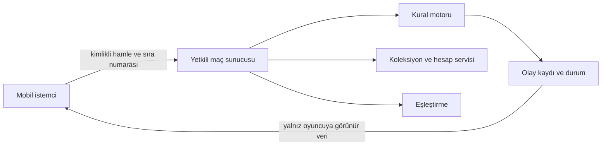

# 09 — Teknik mimari ve online geçiş

## Çalışan prototip

- `oyun/cards.js`: tek kart kaynağı; oyun, baskı ve üretilmiş kart belgesi bunu kullanır.
- `oyun/engine.js`: UI'dan bağımsız, JSON olarak saklanabilir durum makinesi. Girdi doğrulanır; geçersiz hamlede eski durum değişmez. Geçerli hamle yeni durum döndürür.
- `oyun/economy.js`: yerel sahiplik, paket/garanti, üretim/parçalama ve tekil ödül kayıtları.
- `oyun/bot.js`: kendi elini ve açık sahayı kullanan deterministik eğitim rakibi.
- `oyun/decks.js`: üç yasal 20 kartlık deste.
- `oyun/chapters.js`: 10 bölüm, diyalog, hazır deste ve görev koşulları.
- `oyun/app.js`: DOM arayüzü, hedef seçimi, yerel saklama, ses ve isteğe bağlı saat.
- `oyun/pwa.js`, `sw.js`, `manifest.webmanifest`: kurulum, isteğe bağlı görsel indirme, yalnız statik önbellek ve kullanıcı kontrollü güncelleme.
- `oyun/sound.js`: dış kayıt kullanmayan prosedürel ses efektleri ve müzik.
- `oyun/print.js`: aynı veriden 40 kart ve bir kural/deste sayfası üretir.

Node.js 22+ yalnız test/geliştirme için; Python 3 statik servis için. Üçüncü taraf JavaScript paketi yok, `npm install` gerekmiyor. Uygulama dış font, CDN veya analitik isteği yapmaz. İnternet bağlantılı server ya da veritabanı gerekmez. İlk dosya yüklemesinden sonra oyun mantığı yereldir; service worker uygulama kabuğunu önbelleğe alır; oyuncunun ayrıca indirdiği 40 görselle çevrimdışı yeniden açma doğrulanmıştır.

## Maç verisi ve tekrar oynatma

Durum: kural sürümü, seed/RNG durumu, tur/faz, aktif oyuncu, sonuç, zorunlu seçim, oyuncular, log ve hamle geçmişi. Oyuncu: can/enerji, deste/el, savaşçılar, tuzaklar, mezarlık ve görev istatistiği. Sahadaki her kart benzersiz uid alır.

Hamleler: mulligan, play, attack, end, scry, discard, surrender. Hedef: hero:0/1, unit:uid veya diriltmede grave:uid. Başlangıç desteleri ve hamle geçmişi kurallar aynıysa durumu tekrar üretir. JSON uyumsuz sürümü, yasa dışı hamleyi ve aşırı büyük geçmişi reddeder.

Yerel maç ve koleksiyon kaydı tarayıcıya özgüdür. Kullanıcı veriyi değiştirebilir; bu tasarım rekabet veya satın alma güvenliği sağlamaz. İndirilen maç kaydı iki desteyi ve hamleleri içerir; gerçek gizli bilginin korunacağı online tekrar sistemine doğrudan taşınmaz.

## Online sürüm için otorite modeli — uygulanmadı

- İstemci niyeti gönderir; enerji, saldırı, hedef, sahiplik, zaman ve sonucu sunucu doğrular. İstemci “kazandım” sonucu bildiremez.
- Her maç monoton olay numarası tutar. Tekrar gönderilen istek aynı sonucu döndürür, etkisi yeniden uygulanmaz. Eski durum üzerinden hamle reddedilir veya son durumla yanıtlanır.
- Rakibin el/deck/kapalı tuzak kimliği istemciye gönderilmez. Seyirci ve tekrar görünürlüğü ayrıca tasarlanır.
- Başlangıç RNG sunucuda güvenli oluşturulur; maç sonunda denetim kaydına dahil edilir. Yerel RNG hile koruması değildir.
- Saat sunucu otoritesindedir. Yeniden bağlantı tur saatini durdurmaz; geçerli son görünür durum ve kalan süre gönderilir.
- Önerilen kopma politikası: tur kendi saatiyle sona erer; iki ardışık turda hiç hamle/bağlantı yoksa teslim. Ağ hatası ve sunucu kesintisi ayrılmalıdır; kesintide puan/ödül uygulanmaz.
- Maç sonucu, ödül ve lig puanı aynı sonuç kimliğine bağlı tek kez işlenir. Kayıt yarım kalırsa yeniden işleme güvenlidir.
- Misafir hesabı bağlama ve koleksiyon birleştirme önce sahiplik kontrolünden geçer. Yerel prototip kayıtları ekonomik sahiplik kanıtı olarak içeri alınmaz.

## Lig taslağı — uygulanmadı

Başlangıç MMR 1000; ilk 10 maç yerleştirme, K=40; sonra K=24. Beklenen skor `1/(1+10^((rakipMMR-MMR)/400))`; galibiyet 1, beraberlik 0,5, mağlubiyet 0. Güncelleme tek maç işleminde iki oyuncuya birlikte yapılır.

Lig sınırları çalışma taslağı: Çırak <1000, Kalfa 1000–1199, Usta 1200–1399, Destancı 1400–1599, Efsane ≥1600. İlk 10 maçta lig rozeti yerleştirme olarak gösterilir. Eşleştirme ±100 MMR ile başlar; her 15 saniye ±50 genişler, en çok ±300; 60 saniye sonra oyuncuya sürdür/iptal seçimi. Botlar insan ranked oyuncusu gibi gizlenmez.

Sezon 8 hafta; sıfırlama `1000 + 0,5 × (eskiMMR - 1000)`. Ödül yalnız kozmetik. Bu sayılar gerçek oyuncu dağılımıyla ayarlanacak; uygulanan server özelliği değildir.

## Üretim veri ve operasyon kararları

Sağlayıcı seçimi hesap/eşleştirme kadar gerçek zamanlı maç otoritesi, Türkiye gecikmesi, maliyet ve veri aktarımıyla değerlendirilir. Firebase/PlayFab adı yazmak tüm altyapıyı kurmuş sayılmaz.

Gerekli tablolar: users, card_inventory, deck_versions, matches, match_events, reward_transactions, purchases (ödeme varsa), support_cases. Envanter/ödül işlemlerinde benzersiz işlem kimliği ve atomiklik şarttır.

Önce ölçülecek hedefler: maç servis gecikmesi, kopma/geri dönüş, hatalı hamle, sonuç tutarsızlığı, çökme ve maliyet/maç. Yedekleme sıklığı ve saklama süreleri veri hacmi/ülke gereksinimine göre seçilir. Yayın öncesi yedekten geri dönüş tatbikatı, servis alarmı, yetki kontrolü, gizli bilgi sızıntısı testi ve hata telafisi planı gereklidir.
